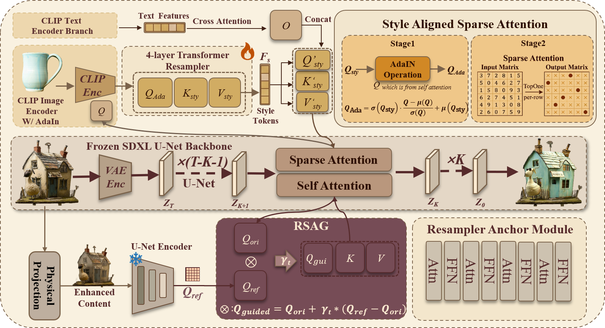

# Rationale: Rationally Conditional Image Synthesis with Structural Consistency and Style Control

<p align="center">
  <a href="https://jackeyloveseven.github.io/Rationale/">🌐 Project Page</a> &nbsp;|&nbsp;
  <a href="#">📄 Paper (Coming Soon)</a> &nbsp;|&nbsp;
  <a href="#">💻 Code (Coming Soon)</a> &nbsp;|&nbsp;
  <a href="#">🗂️ SMSS Dataset (Coming Soon)</a>
</p>

<p align="center">
  <b>ACM International Conference on Multimedia 2026</b>
</p>

---

## Abstract

A fundamental challenge in controllable image generation is the conflict between concurrent guidance signals: structural conditioning and style conditioning compete for the same attention queries within the diffusion model's latent space, producing object distortions, incomplete stylization, or degraded photorealism.

**Rationale** resolves this through three tightly coupled components:

- **Resampler** — a lightweight trainable network that encodes a style reference into structure-aligned tokens, trained on our curated SMSS dataset.
- **RSAG (Relative Self-Attention Guidance)** — steers self-attention queries toward a structural prior via a distributional shift formulation with a provable *O*(√T) sublinear regret bound.
- **Style-Aligned Sparse Attention** — decouples content and style at the query level using AdaIN normalization and deterministic Top-1 matching, preventing semantic bleed across regions.

Rationale achieves the best content preservation among compared methods (**LPIPS 0.483**, **ArtFID 25.029**) and is consistently preferred by human evaluators (**4.5/5**, 187 participants).

---

## Results

| Method | ArtFID ↓ | FID ↓ | LPIPS ↓ | User Pref. ↑ |
|---|---|---|---|---|
| CSGO | 36.930 | 21.207 | 0.663 | 4.0 |
| StyleShot (lineart) | 35.488 | 20.639 | 0.640 | 3.9 |
| StyTr2 | 30.708 | 18.889 | 0.544 | 4.1 |
| StyleID | 28.778 | 18.122 | 0.505 | 4.3 |
| Attn. Distillation | 28.977 | 17.504 | 0.566 | 3.8 |
| **Rationale (Ours)** | **25.029** | **16.877** | **0.483** | **4.5** |

---

## Method Overview



The framework runs on a frozen SDXL backbone. At each U-Net block, RSAG steers self-attention queries toward a cached structural prior, while Style-Aligned Sparse Attention injects style features via AdaIN-modulated queries and Top-1 sparse matching. The Resampler is the only trainable component.

---

## SMSS Dataset

A style-balanced dataset of **60,000 images across 78 categories**, addressing the photorealistic-image bias in prior training data. Code and dataset will be released upon publication.

---

## BibTeX

```bibtex
@inproceedings{anonymous2026rationale,
  title     = {Rationale: Rationally Conditional Image Synthesis
               with Structural Consistency and Style Control},
  author    = {Anonymous Authors},
  booktitle = {Proceedings of the ACM International Conference on Multimedia},
  year      = {2026}
}
```

---

<p align="center">Page design inspired by <a href="https://huangrh99.github.io/SpectraReward/">SpectraReward</a>.</p>
