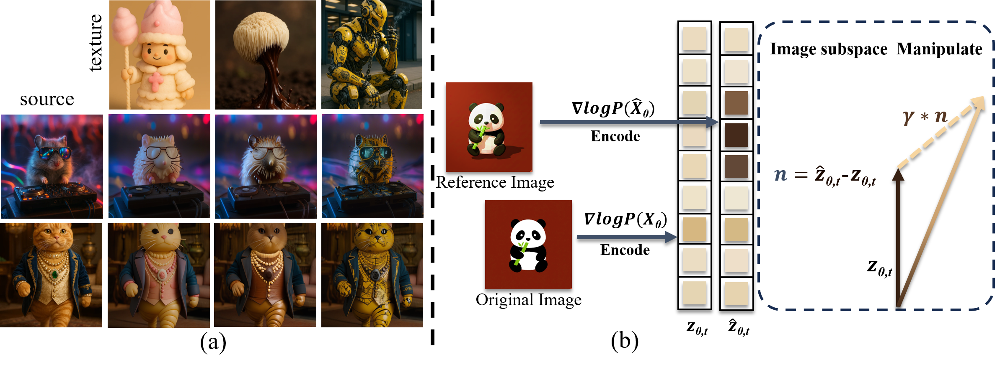
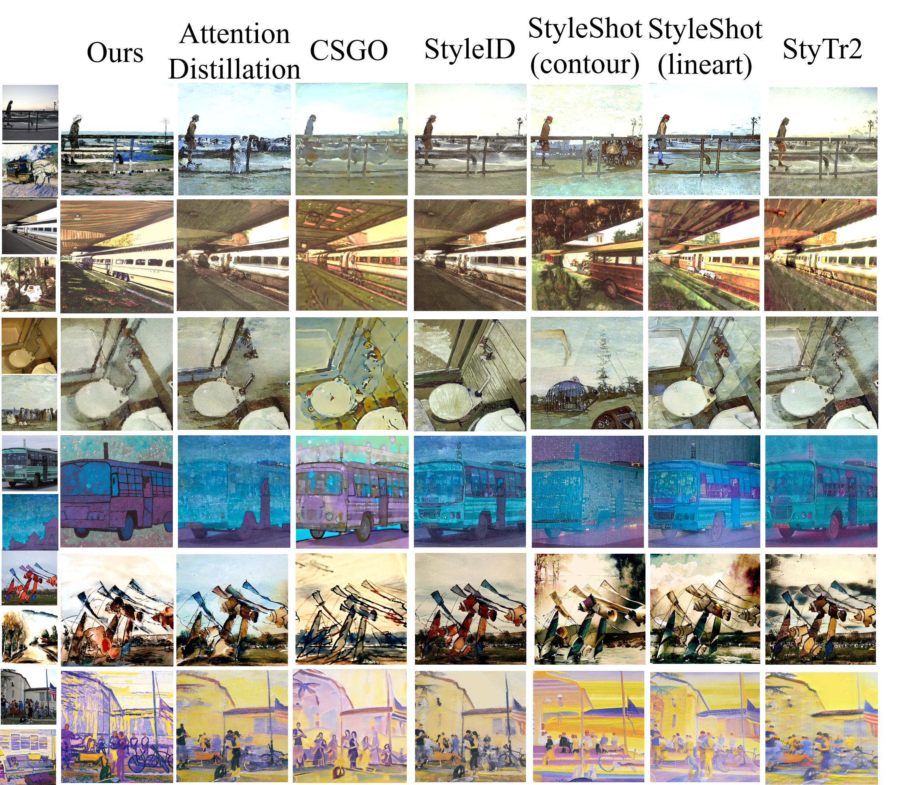
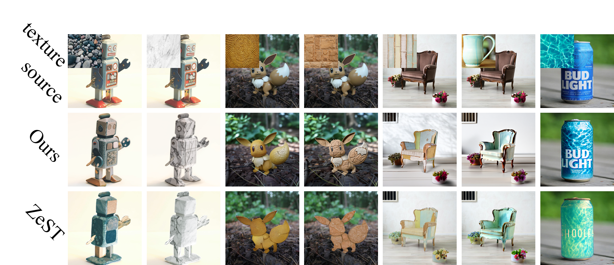
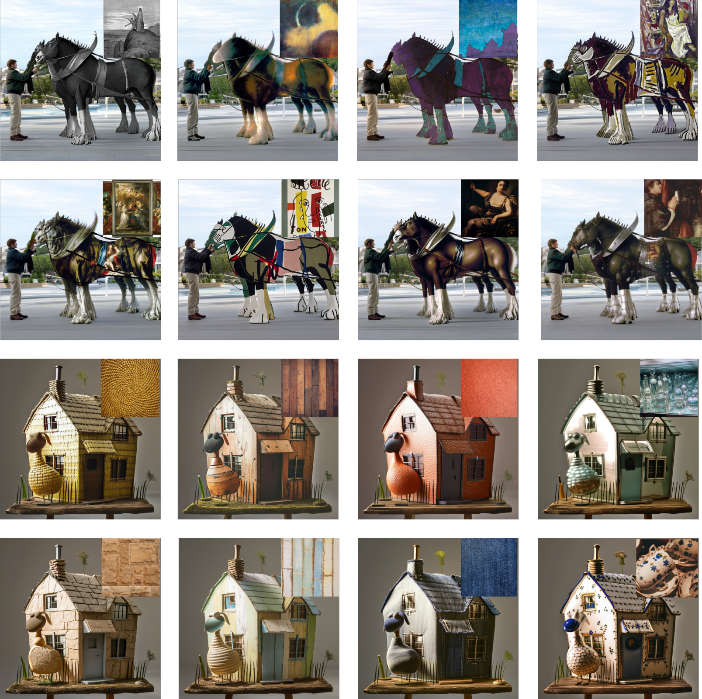

# Rationale: Rationally Conditional Image Synthesis with Structural Consistency and Distribution Shift

<div align="center">

[](https://jackeyloveseven.github.io/Rationale/)
[](https://doi.org/10.1145/3767308.3835277)
[](https://jackeyloveseven.github.io/Rationale/)
[](https://jackeyloveseven.github.io/Rationale/)

**ACM International Conference on Multimedia 2026**

</div>

---

## Overview



Concurrent guidance signals—structural conditioning and style conditioning—compete for the same attention queries within a diffusion model's latent space. Naive combinations (e.g., ControlNet + IP-Adapter) produce conflicting attention distributions, resulting in object distortions, incomplete stylization, and degraded photorealism.

**Rationale** resolves this with a hybrid framework that establishes a shared structural prior, enabling precise, photorealistic stylization without test-time optimization.

---

## Method


Built on a frozen **SDXL** backbone, Rationale introduces three tightly coupled components:

| Component | Role |
|---|---|
| **Resampler** | Lightweight trainable encoder that maps a style reference into structure-aligned tokens via a 4-layer Transformer with AdaIN-modulated queries |
| **RSAG** (Relative Self-Attention Guidance) | Parameter-free module that steers self-attention queries toward a cached structural prior via a distributional shift $Q_\text{guided} = Q_\text{ori} + \gamma_t(Q_\text{ref} - Q_\text{ori})$, with a provable $O(\sqrt{T})$ regret bound |
| **Style-Aligned Sparse Attention** | Decouples content and style at the query level via AdaIN normalization + deterministic Top-1 matching, preventing semantic bleed across spatial regions |

The Resampler is the only trainable component. RSAG and Style-Aligned Sparse Attention operate entirely at inference time with no parameter updates.

---

## Results

### Style Transfer (MS-COCO × WikiArt)

| Method | ArtFID ↓ | FID ↓ | LPIPS ↓ | LPIPS_gray ↓ | User Pref. ↑ |
|---|:---:|:---:|:---:|:---:|:---:|
| CSGO | 36.930 | 21.207 | 0.663 | 0.539 | 4.0 |
| StyleShot (contour) | 36.426 | 19.580 | 0.770 | 0.683 | 3.2 |
| StyleShot (lineart) | 35.488 | 20.639 | 0.640 | 0.529 | 3.9 |
| StyTr2 | 30.708 | 18.889 | 0.544 | 0.449 | 4.1 |
| StyleID | 28.778 | 18.122 | 0.505 | 0.439 | 4.3 |
| Attn. Distillation | 28.977 | 17.504 | 0.566 | 0.470 | 3.8 |
| **Rationale (Ours)** | **25.029** | **16.877** | **0.483** | **0.433** | **4.5** |

### Material Transfer

| Method | CLIP-I ↑ | DINOv2 ↑ | Photorealism ↑ | Fidelity ↑ |
|---|:---:|:---:|:---:|:---:|
| ZeST | 22.280 | 32.158 | 4.05 | 3.78 |
| **Rationale (Ours)** | **34.143** | **50.242** | **4.81** | **4.72** |

User study: **187 participants**, 5-point Likert scale, 5,000+ ratings, $p < 0.05$ (Wilcoxon signed-rank test).

---

## Qualitative Results

<table>
  <tr>
    <td align="center"><br><b>Style Transfer</b></td>
  </tr>
  <tr>
    <td align="center"><br><b>Material Transfer</b></td>
  </tr>
  <tr>
    <td align="center"><br><b>Local Style Transfer</b></td>
  </tr>
</table>

---

## SMSS Dataset

A style-balanced dataset of **60,000 images across 78 categories**, curated to address the photorealistic-image bias in prior training corpora. Includes styles spanning artistic painting, material textures, and illustrated designs. Category-Aware Uniform Sampling ensures equal gradient contribution from rare styles during training.

Dataset and training code will be released upon publication.

---

## BibTeX

```bibtex
@inproceedings{chengyanli2026rationale,
  title     = {Rationale: Rationally Conditional Image Synthesis
               with Structural Consistency and Distribution Shift},
  author    = {chengyanli},
  booktitle = {Proceedings of the ACM International Conference on Multimedia},
  year      = {2026},
  doi       = {10.1145/3767308.3835277}
}
```
